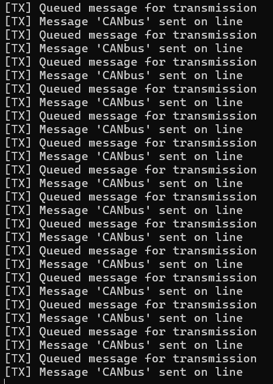
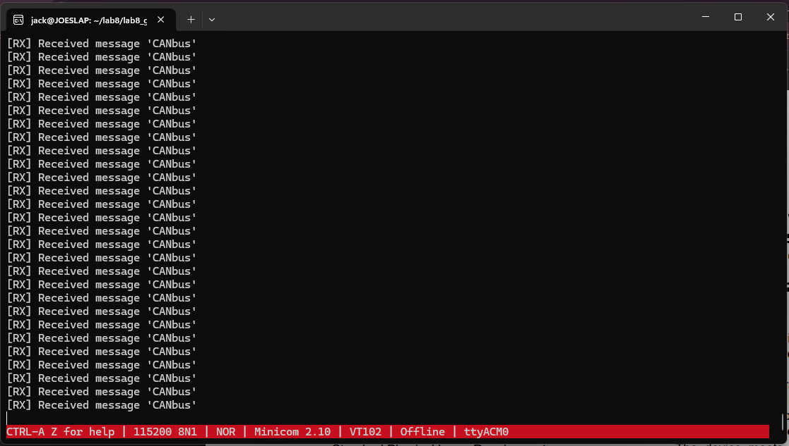
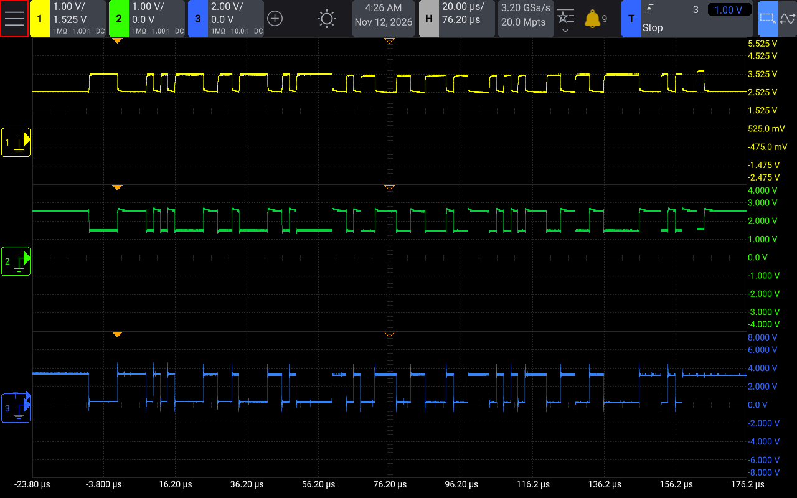

# Lab 8 Results
## Activity 0
**Transmission Side**: 
  - Sending message 'CANbus' every 1 second

**Reception Side**: 
  - Received the 'CANbus' message every 1 second after it was transmitted

**Oscilloscope**: 
  - **Key**
    - Probe 1 is CAN High
    - Probe 2 is CAN Low
    - Probe 3 is microcontroller TX
  - **Observations**
    - The microcontroller outputs 0V and 3.3V signals.
    - On the CAN Bus, 0s are translated to a differential signal where CAN Low is pulled to 1.5V and CAN High is pulled to 3.5V.
    - 1s are translated to 2.5V on both lines.

## Activity 1

**Oscilloscope**:

  - **Key**
    - Probe 1 is CAN High
    - Probe 2 is CAN Low
    - Probe 3 is microcontroller TX

### Continuous High Priority Transmission
**Observations**
  - When the high priority message is set to broadcast continuously, the lower priority message never had a chance to be transmitted. The low priority side occasionally believed it had transmitted, but this message was never observed on the high priority side or on the oscilloscope.

**High Priority Side**:
")

**Low-Priority Side**:
")

### 10ms High Priority Transmission
**Observations**
  - With a 180us to ~1ms delay between high priority transmissions, the start of the low priority message was observed on the oscilloscope, but the high priority side only reported a CAN reception error.
  - It wasn't until about 10ms between high priority transmissions that the low priority transmission was able to occasionally get through fully. This was periodically (but too briefly to capture) shown on the oscilloscope, but it is shown in the terminal outputs below.

**High Priority Side**:
")

**Low-Priority Side**:
")